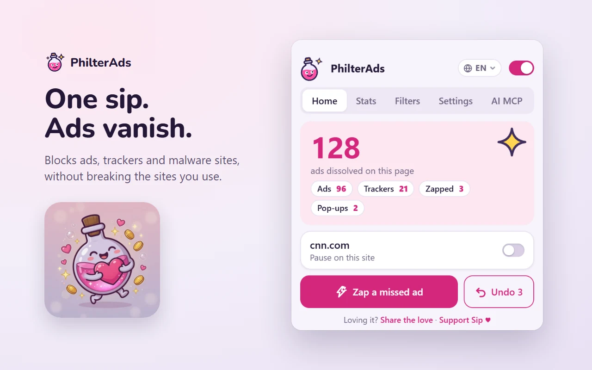
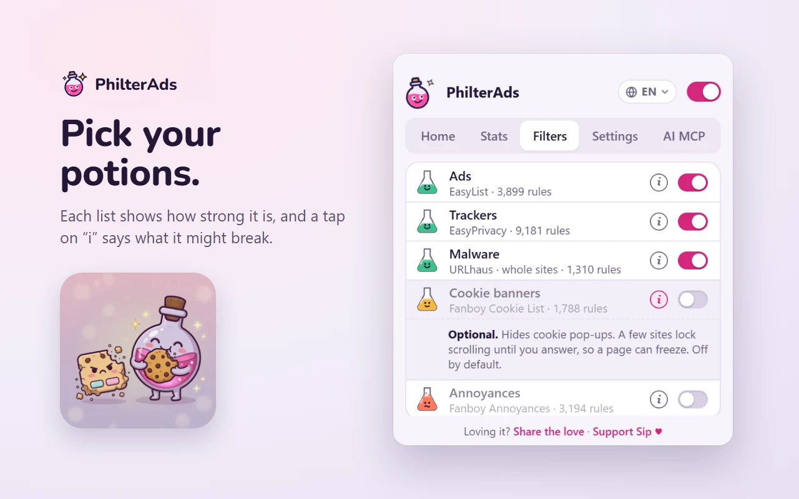
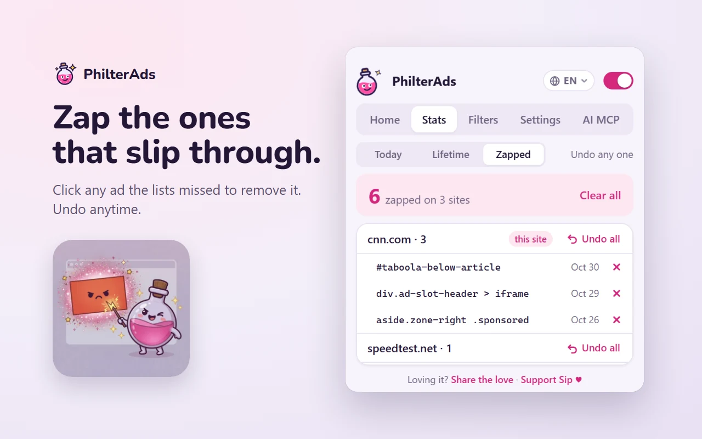
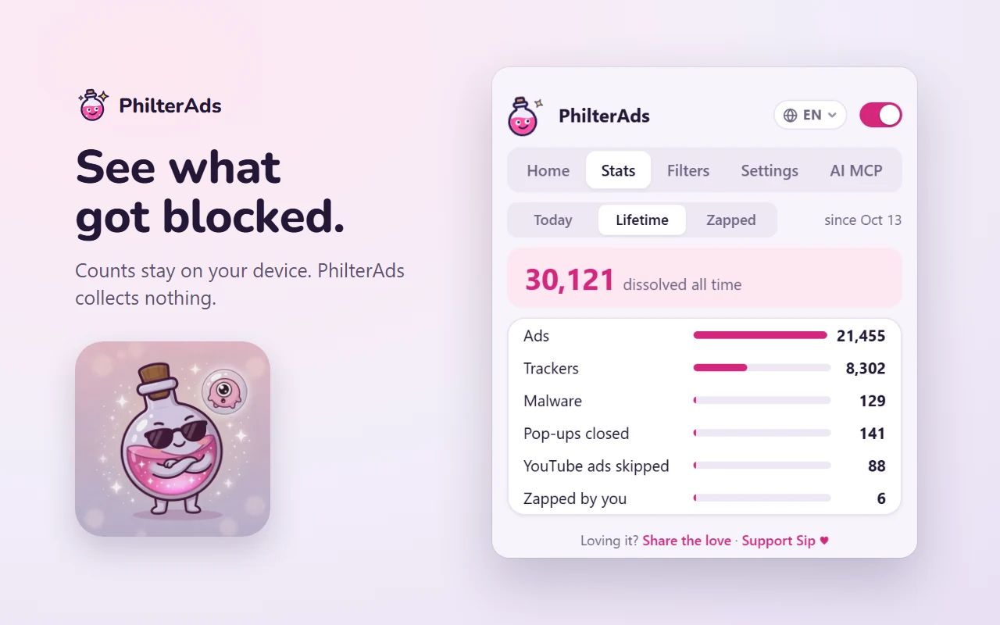
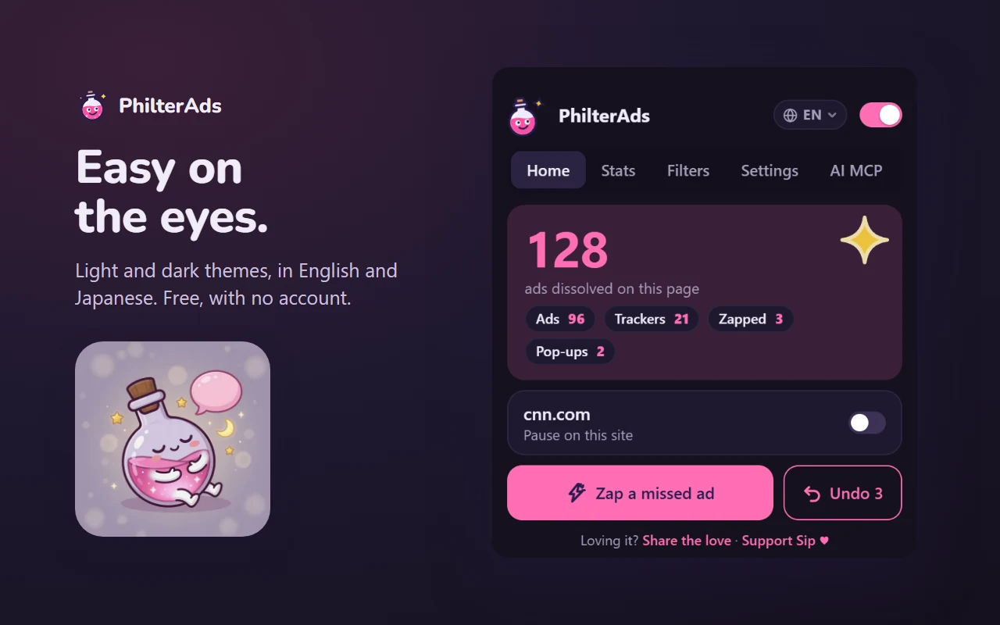

<p align="center">
  <a href="https://philterads.com"></a>
</p>

<p align="center">
  <a href="https://github.com/PhilterAds/philterads/releases/latest"></a>
  <a href="LICENSE"></a>
  
  
</p>

<p align="center">
  <b>A free ad blocker for Chrome and Edge.</b><br>
  Blocks ads, trackers and malware sites, and closes pop-up ad tabs, without breaking the sites you use.<br>
  <a href="https://philterads.com">philterads.com</a> · <a href="https://microsoftedge.microsoft.com/addons/detail/philterads/epaelpoafnbapdflkoflbpdmbflojoab">Get it for Edge</a> · <a href="#install">Install</a> · <a href="#roadmap">Roadmap</a> · <a href="docs/TECHNICAL.md">How it works</a>
</p>

---

## Why PhilterAds

- **Blocks what you don't want.** Ads, trackers and known malware sites, from six well-known filter lists plus hand-tuned rules.
- **Never breaks what you need.** Sign-in, payment and captcha pages are protected by a safety rule the tests check on every build. When it's a choice between a working site and one more blocked ad, the working site wins.
- **Closes pop-up ad tabs.** Scam tabs that open when you click a page get closed before they load.
- **Zap the ones that slip through.** Click any ad the lists missed and it stays gone on that site. Undo any time.
- **Collects nothing.** No account, no analytics, no data leaves your browser. The code is open, so you can check.

## Screenshots

<table>
  <tr>
    <td width="50%"></td>
    <td width="50%"></td>
  </tr>
  <tr>
    <td width="50%"></td>
    <td width="50%"></td>
  </tr>
  <tr>
    <td colspan="2" align="center"></td>
  </tr>
</table>

## Install

### Microsoft Edge Add-ons

**[Get PhilterAds for Microsoft Edge](https://microsoftedge.microsoft.com/addons/detail/philterads/epaelpoafnbapdflkoflbpdmbflojoab)**: one-click install with automatic updates.

<a href="https://microsoftedge.microsoft.com/addons/detail/philterads/epaelpoafnbapdflkoflbpdmbflojoab"></a>

### Chrome Web Store

The Chrome listing is in review. Until it's approved, install from GitHub below. The link will appear here and on [philterads.com](https://philterads.com).

### From GitHub (works today, about a minute)

1. **Download** [`philterads.zip`](https://github.com/PhilterAds/philterads/releases/latest/download/philterads.zip) from the latest release.
2. **Unzip it** into a folder you'll keep, for example `Documents\PhilterAds`. Don't delete the folder afterwards: the browser runs the extension from it.
3. **Open the extensions page**: type `chrome://extensions` (Chrome) or `edge://extensions` (Edge) in the address bar.
4. **Turn on Developer mode**: a switch at the top right in Chrome, or in the left sidebar in Edge.
5. Click **Load unpacked** and pick the folder from step 2. It's the one that contains `manifest.json`.
6. **Pin it**: click the puzzle-piece icon in the toolbar, then the pin next to PhilterAds.

Using another ad blocker in the same browser profile? Turn it off so the two don't fight.

<details>
<summary><b>Updating a GitHub install</b></summary>

Download the new `philterads.zip` and unzip it over the same folder, replacing the files. Then click the reload arrow on the PhilterAds card on the extensions page. Your settings and zapped items stay, as long as the folder path doesn't change.

The browser may remind you that developer-mode extensions are turned on. That's normal for anything installed this way.
</details>

<details>
<summary><b>For developers: run it from a clone, with one-click updates</b></summary>

```
git clone https://github.com/PhilterAds/philterads.git
cd philterads
npm install
npm run install-updater   # Windows, optional: lets the popup pull updates from GitHub
```

Then load the cloned folder unpacked, as in steps 3 to 5 above. Details are in [docs/TECHNICAL.md](docs/TECHNICAL.md).
</details>

## Roadmap

This list is also on the site: [philterads.com/#roadmap](https://philterads.com/#roadmap).

**Out now, v1.6**
- Ads, trackers, malware sites and pop-up ad tabs blocked
- **Zap**: pick any ad the lists missed and it stays hidden on that site; undo one, a whole site, or everything
- Stats for today and all time, plus a **Zapped** tab listing everything you zapped
- Light and dark themes, and English or 日本語 in the popup
- Open source under GPLv3, with versioned [releases](https://github.com/PhilterAds/philterads/releases)

**Up next**
- Chrome Web Store listing (in review). The [Edge Add-ons listing](https://microsoftedge.microsoft.com/addons/detail/philterads/epaelpoafnbapdflkoflbpdmbflojoab) is live.
- **AI control over MCP**: a small local `philterads-mcp` server, so Claude, Cursor or any MCP app can run PhilterAds for you, for example *"This site is broken. Fix it."* It runs on your own computer, and no browsing history goes to the AI. Design: [docs/MCP.md](docs/MCP.md)
- A welcome page on first install

**Later**
- **Live AI Filter**: a small on-device model that spots brand-new ads the lists haven't caught yet
- **Defender**: on-device warnings for phishing pages, fake download buttons and scam pop-ups
- Firefox (desktop and Android), then Opera, then Safari. See [docs/BROWSERS.md](docs/BROWSERS.md)
- More languages, and supporters vote on what comes next

## Troubleshooting

- **A site misbehaves**: open the popup, choose **Pause on this site**, then reload the page. If that fixes it, a list rule is to blame. Please tell us which site.
- **Cookie banners still show**: turn on the *Cookie banners* list in the popup's Filters tab. It's off by default because it's the list most likely to hide something useful.
- **Something else**: [open an issue](https://github.com/PhilterAds/philterads/issues) or email contact@philterads.com.

## Contributing

Broken sites, missed ads and pull requests are welcome. See [CONTRIBUTING.md](CONTRIBUTING.md). For how the blocking, the list build and the tests work, read [docs/TECHNICAL.md](docs/TECHNICAL.md).

## Licence and credits

PhilterAds is free software under the [GNU GPL v3](LICENSE). The filter lists belong to their authors and keep their own licences: see [THIRD_PARTY_NOTICES.md](THIRD_PARTY_NOTICES.md). The PhilterAds name, the Sip mascot and the logo are not covered by the GPL; forks need their own name and artwork.

Found a security problem? Please report it privately: [SECURITY.md](SECURITY.md).
